# Koda · animaciones

Las 42 animaciones de Koda Chibi, en 512×512 px y con fondo transparente, listas para usar como sticker, fondo, avatar o donde quieras.

- `gif/`: GIF animado, para la PC, chats y la web.
- `webp/`: WebP animado. Es el formato de los stickers animados de WhatsApp (512×512, menos de 500 KB; estos pesan menos de 6 KB). Telegram pide WEBM para los stickers animados, así que no sirve para eso.

Las animaciones que pasan una sola vez en la app (por ejemplo «Saltar») acá se repiten y se quedan quietas un momento en su última pose.

Descarga directa: clic en el enlace y «Download raw file», o el enlace `raw` de cada fila.

Se generan desde la hoja de sprites de 32 px de Koda Chibi (la misma que usa la app en `apps/desktop-tauri/frontend/koda/`). Licencia: la del repositorio ([LICENSE](../../LICENSE)).

## Estados de Koda (lo que muestra la isla)

| | Animación | Cuándo | Archivos |
|---|---|---|---|
| 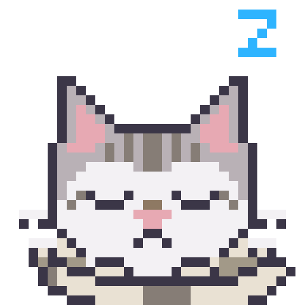 | **Reposo** | Koda está abierto y no hay nada en curso: la isla en reposo. | [gif](gif/00-reposo.gif) · [webp](webp/00-reposo.webp) · [raw](https://raw.githubusercontent.com/Alvarogds04/koda/main/assets/koda/gif/00-reposo.gif) |
| 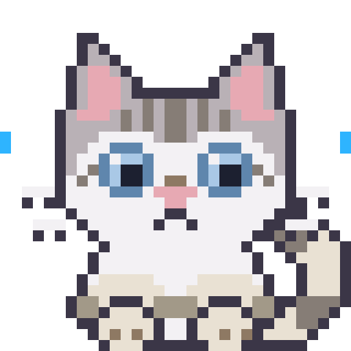 | **Escucha** | Dictás o escribís: Koda atiende con las orejas paradas. | [gif](gif/01-escucha.gif) · [webp](webp/01-escucha.webp) · [raw](https://raw.githubusercontent.com/Alvarogds04/koda/main/assets/koda/gif/01-escucha.gif) |
| 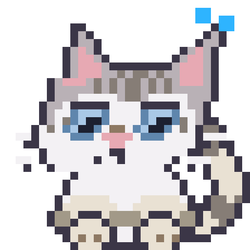 | **Piensa** | Pi está razonando antes de responder; la cabeza ladeada es el “mmm”. | [gif](gif/02-piensa.gif) · [webp](webp/02-piensa.webp) · [raw](https://raw.githubusercontent.com/Alvarogds04/koda/main/assets/koda/gif/02-piensa.gif) |
| 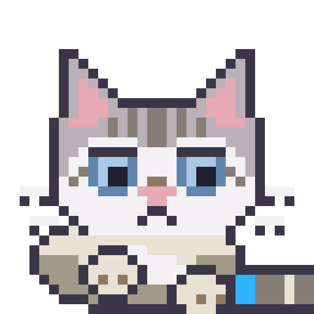 | **Trabaja** | Pi está ejecutando: Koda amasa y la cola es la barra de progreso (la barra real se dibuja encima). | [gif](gif/03-trabaja.gif) · [webp](webp/03-trabaja.webp) · [raw](https://raw.githubusercontent.com/Alvarogds04/koda/main/assets/koda/gif/03-trabaja.gif) |
| 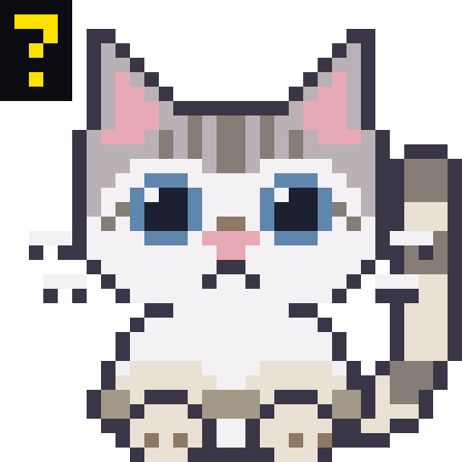 | **Espera tu sí** | Hay un permiso pendiente: Koda se sienta erguido y golpetea con la pata. Nada se mueve sin tu sí. | [gif](gif/04-espera.gif) · [webp](webp/04-espera.webp) · [raw](https://raw.githubusercontent.com/Alvarogds04/koda/main/assets/koda/gif/04-espera.gif) |
| 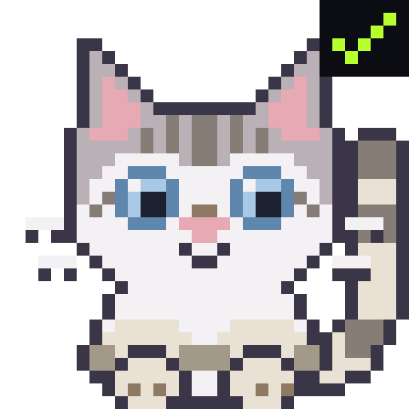 | **Terminó** | Pi terminó bien: parpadeo lento y cola arriba, la señal gatuna de confianza. | [gif](gif/05-termino.gif) · [webp](webp/05-termino.webp) · [raw](https://raw.githubusercontent.com/Alvarogds04/koda/main/assets/koda/gif/05-termino.gif) |
| 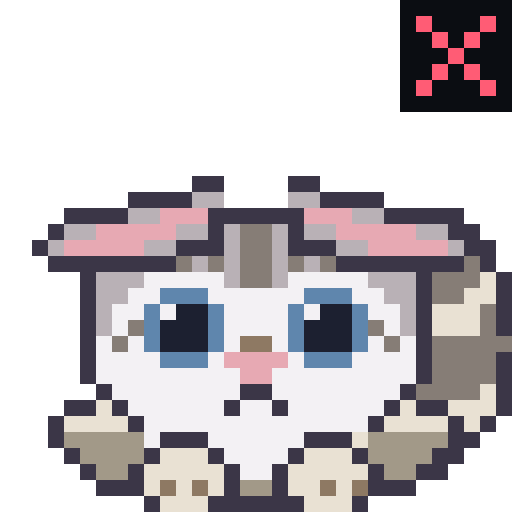 | **Error / sin conexión** | Se cayó la conexión o Pi falló: orejas de avión y cola inflada; no se mueve hasta que vuelva. | [gif](gif/06-error.gif) · [webp](webp/06-error.webp) · [raw](https://raw.githubusercontent.com/Alvarogds04/koda/main/assets/koda/gif/06-error.gif) |

## Emociones

| | Animación | Cuándo | Archivos |
|---|---|---|---|
| 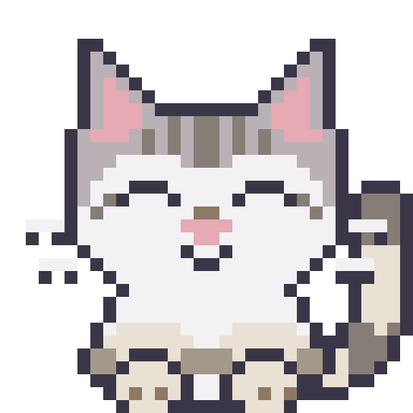 | **Feliz** | Un trabajo salió bien, o lo saludás al abrir Koda. | [gif](gif/07-feliz.gif) · [webp](webp/07-feliz.webp) · [raw](https://raw.githubusercontent.com/Alvarogds04/koda/main/assets/koda/gif/07-feliz.gif) |
| 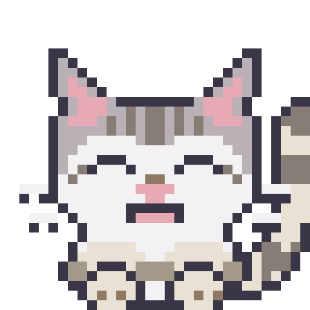 | **Muy feliz / emocionado** | Terminó una tarea grande o completaste algo: Koda salta de contento. | [gif](gif/08-muy-feliz.gif) · [webp](webp/08-muy-feliz.webp) · [raw](https://raw.githubusercontent.com/Alvarogds04/koda/main/assets/koda/gif/08-muy-feliz.gif) |
| 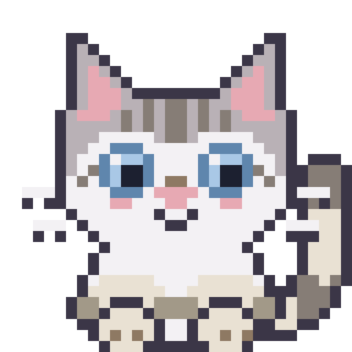 | **Cariñoso** | Le agradecés a Koda o le escribís algo lindo: parpadeo lento y un corazón. | [gif](gif/09-carinoso.gif) · [webp](webp/09-carinoso.webp) · [raw](https://raw.githubusercontent.com/Alvarogds04/koda/main/assets/koda/gif/09-carinoso.gif) |
| 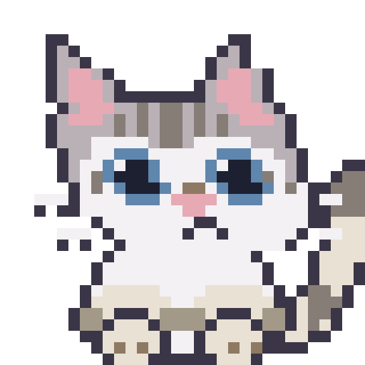 | **Curioso** | Aparece algo nuevo (una carpeta, una pregunta) y Koda se asoma a mirar. | [gif](gif/10-curioso.gif) · [webp](webp/10-curioso.webp) · [raw](https://raw.githubusercontent.com/Alvarogds04/koda/main/assets/koda/gif/10-curioso.gif) |
| 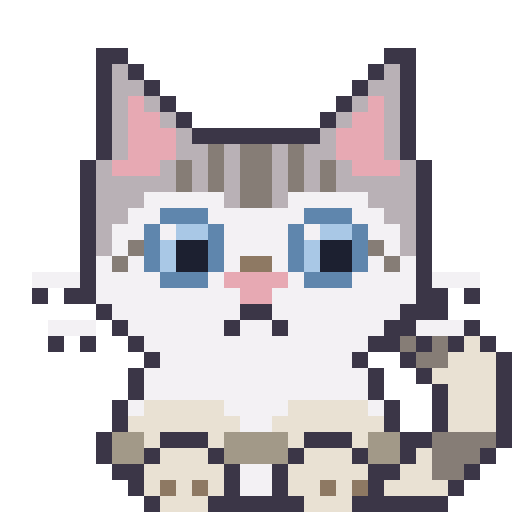 | **Sorprendido** | Un cambio inesperado (llegó un archivo, algo falló de golpe). | [gif](gif/11-sorprendido.gif) · [webp](webp/11-sorprendido.webp) · [raw](https://raw.githubusercontent.com/Alvarogds04/koda/main/assets/koda/gif/11-sorprendido.gif) |
| 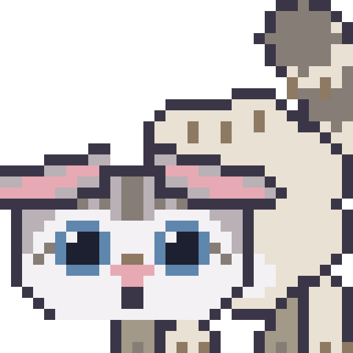 | **Asustado** | Una acción peligrosa o un error grave: Koda se eriza. | [gif](gif/12-asustado.gif) · [webp](webp/12-asustado.webp) · [raw](https://raw.githubusercontent.com/Alvarogds04/koda/main/assets/koda/gif/12-asustado.gif) |
| 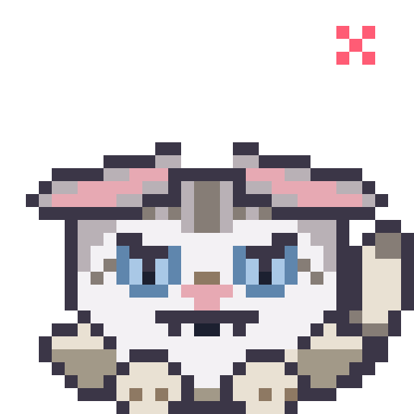 | **Enojado** | Un conflicto o un rechazo repetido: Koda bufa (pero no rompe nada). | [gif](gif/13-enojado.gif) · [webp](webp/13-enojado.webp) · [raw](https://raw.githubusercontent.com/Alvarogds04/koda/main/assets/koda/gif/13-enojado.gif) |
| 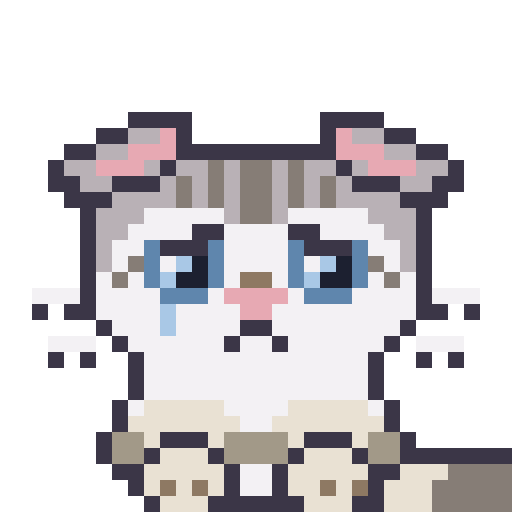 | **Triste** | Falló algo importante o se perdió trabajo: acompaña en silencio. | [gif](gif/14-triste.gif) · [webp](webp/14-triste.webp) · [raw](https://raw.githubusercontent.com/Alvarogds04/koda/main/assets/koda/gif/14-triste.gif) |
| 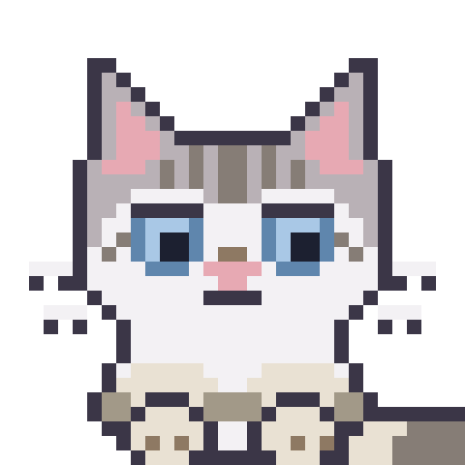 | **Aburrido** | Lleva rato sin actividad: Koda bosteza y mira a otro lado. | [gif](gif/15-aburrido.gif) · [webp](webp/15-aburrido.webp) · [raw](https://raw.githubusercontent.com/Alvarogds04/koda/main/assets/koda/gif/15-aburrido.gif) |
| 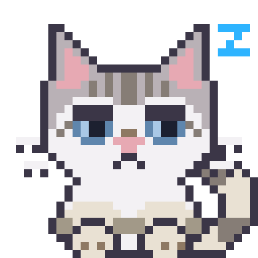 | **Somnoliento** | Es de noche o Koda lleva horas abierto sin uso. | [gif](gif/16-somnoliento.gif) · [webp](webp/16-somnoliento.webp) · [raw](https://raw.githubusercontent.com/Alvarogds04/koda/main/assets/koda/gif/16-somnoliento.gif) |
| 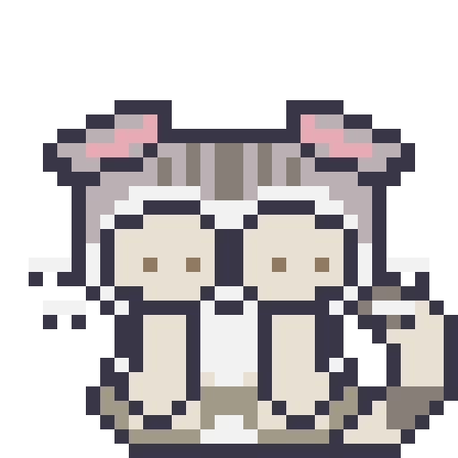 | **Avergonzado / tímido** | Le decís algo halagador o Koda se equivoca y se hace el distraído. | [gif](gif/17-timido.gif) · [webp](webp/17-timido.webp) · [raw](https://raw.githubusercontent.com/Alvarogds04/koda/main/assets/koda/gif/17-timido.gif) |
| 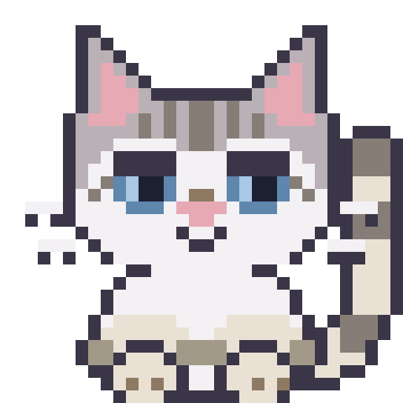 | **Orgulloso** | Pi terminó una tarea difícil: Koda levanta el mentón. | [gif](gif/18-orgulloso.gif) · [webp](webp/18-orgulloso.webp) · [raw](https://raw.githubusercontent.com/Alvarogds04/koda/main/assets/koda/gif/18-orgulloso.gif) |
| 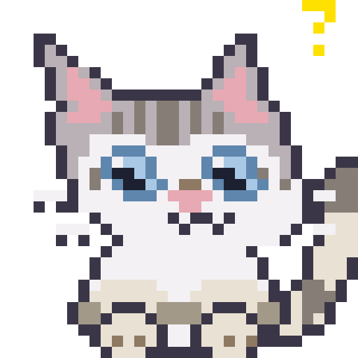 | **Confundido** | No entendió el pedido: pregunta de vuelta en vez de adivinar. | [gif](gif/19-confundido.gif) · [webp](webp/19-confundido.webp) · [raw](https://raw.githubusercontent.com/Alvarogds04/koda/main/assets/koda/gif/19-confundido.gif) |
| 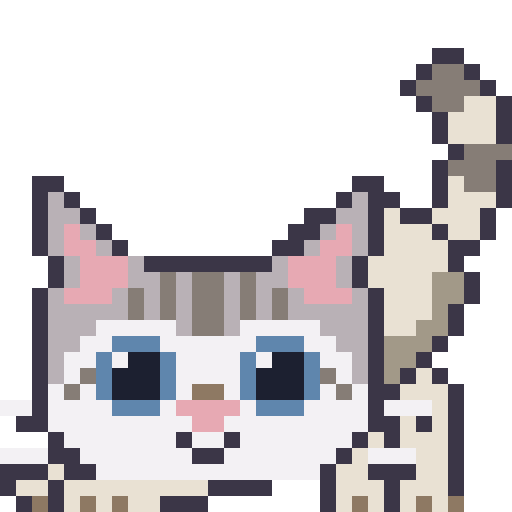 | **Juguetón** | Quedó algo corto y Koda propone seguir: invitación a jugar. | [gif](gif/20-jugueton.gif) · [webp](webp/20-jugueton.webp) · [raw](https://raw.githubusercontent.com/Alvarogds04/koda/main/assets/koda/gif/20-jugueton.gif) |

## Acciones de gato

| | Animación | Cuándo | Archivos |
|---|---|---|---|
|  | **Idle · respirar** | Base de todo lo demás: Koda vivo y quieto entre acciones. | [gif](gif/21-respirar.gif) · [webp](webp/21-respirar.webp) · [raw](https://raw.githubusercontent.com/Alvarogds04/koda/main/assets/koda/gif/21-respirar.gif) |
|  | **Parpadear** | Cada 4–6 s en cualquier estado con ojos abiertos. | [gif](gif/22-parpadear.gif) · [webp](webp/22-parpadear.webp) · [raw](https://raw.githubusercontent.com/Alvarogds04/koda/main/assets/koda/gif/22-parpadear.gif) |
|  | **Tic de oreja** | Reacción a un sonido o notificación leve (sin cambio de estado). | [gif](gif/23-tic-oreja.gif) · [webp](webp/23-tic-oreja.webp) · [raw](https://raw.githubusercontent.com/Alvarogds04/koda/main/assets/koda/gif/23-tic-oreja.gif) |
| 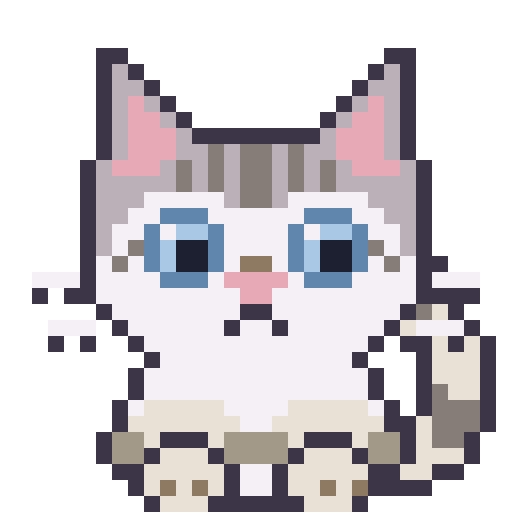 | **Mover la cola** | Espera activa o contento tranquilo; también marca el ritmo en listas largas. | [gif](gif/24-cola.gif) · [webp](webp/24-cola.webp) · [raw](https://raw.githubusercontent.com/Alvarogds04/koda/main/assets/koda/gif/24-cola.gif) |
|  | **Bostezar** | Tras mucho rato en reposo, antes de dormirse. | [gif](gif/25-bostezar.gif) · [webp](webp/25-bostezar.webp) · [raw](https://raw.githubusercontent.com/Alvarogds04/koda/main/assets/koda/gif/25-bostezar.gif) |
|  | **Estirarse** | Al volver Koda a la actividad después de una pausa larga. | [gif](gif/26-estirarse.gif) · [webp](webp/26-estirarse.webp) · [raw](https://raw.githubusercontent.com/Alvarogds04/koda/main/assets/koda/gif/26-estirarse.gif) |
| 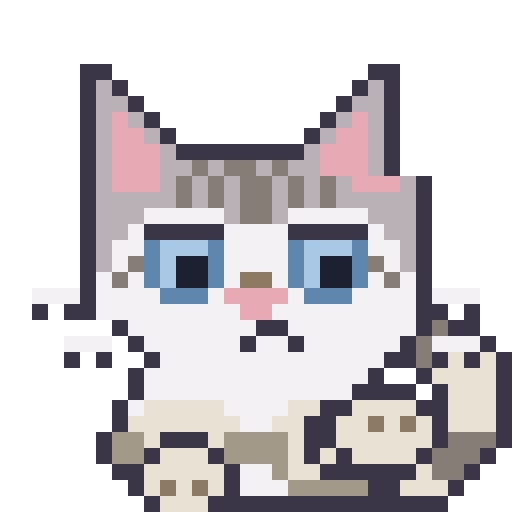 | **Lamerse la pata** | Pausa larga sin trabajo: Koda se acicala mientras espera. | [gif](gif/27-lamerse.gif) · [webp](webp/27-lamerse.webp) · [raw](https://raw.githubusercontent.com/Alvarogds04/koda/main/assets/koda/gif/27-lamerse.gif) |
| 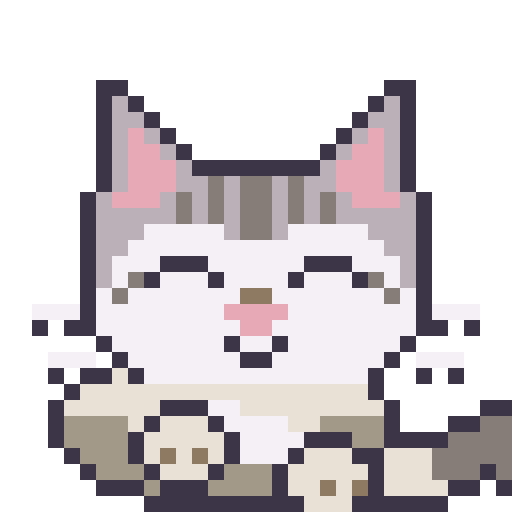 | **Amasar** | Espera cómoda sin barra de progreso (el estado «Trabaja» le suma la barra). | [gif](gif/28-amasar.gif) · [webp](webp/28-amasar.webp) · [raw](https://raw.githubusercontent.com/Alvarogds04/koda/main/assets/koda/gif/28-amasar.gif) |
| 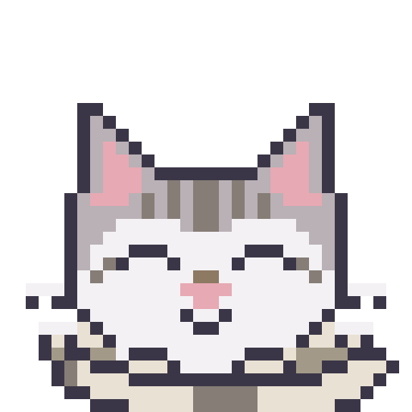 | **Ronronear** | Reacción a una caricia o a un «gracias»; mantiene la sensación de compañía. | [gif](gif/29-ronronear.gif) · [webp](webp/29-ronronear.webp) · [raw](https://raw.githubusercontent.com/Alvarogds04/koda/main/assets/koda/gif/29-ronronear.gif) |
| 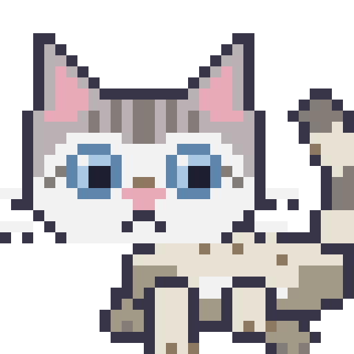 | **Caminar** | Koda cruza la isla al pasar de un modo a otro (compacta ⇄ expandida). | [gif](gif/30-caminar.gif) · [webp](webp/30-caminar.webp) · [raw](https://raw.githubusercontent.com/Alvarogds04/koda/main/assets/koda/gif/30-caminar.gif) |
| 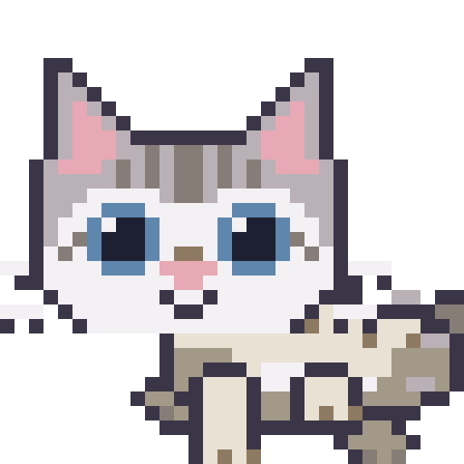 | **Correr** | Koda va deprisa: carga larga, llegada de un resultado, o un aviso importante. | [gif](gif/31-correr.gif) · [webp](webp/31-correr.webp) · [raw](https://raw.githubusercontent.com/Alvarogds04/koda/main/assets/koda/gif/31-correr.gif) |
| 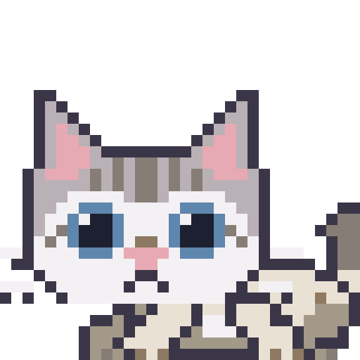 | **Saltar** | Salto de reacción a un evento grande (llegada de resultado, cambio de isla). | [gif](gif/32-saltar.gif) · [webp](webp/32-saltar.webp) · [raw](https://raw.githubusercontent.com/Alvarogds04/koda/main/assets/koda/gif/32-saltar.gif) |
| 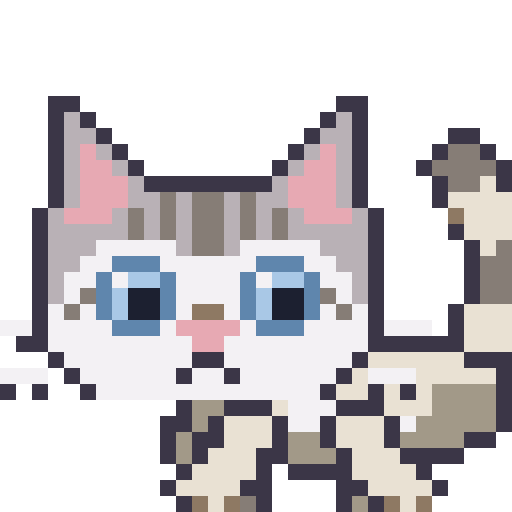 | **Sentarse / echarse** | Koda llega a su sitio y se acomoda al terminar un traslado. | [gif](gif/33-sentarse.gif) · [webp](webp/33-sentarse.webp) · [raw](https://raw.githubusercontent.com/Alvarogds04/koda/main/assets/koda/gif/33-sentarse.gif) |
| 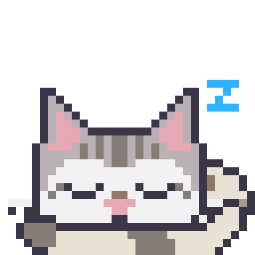 | **Dormir enroscado** | Koda inactivo por la noche o tras una hora sin uso. | [gif](gif/34-dormir.gif) · [webp](webp/34-dormir.webp) · [raw](https://raw.githubusercontent.com/Alvarogds04/koda/main/assets/koda/gif/34-dormir.gif) |
| 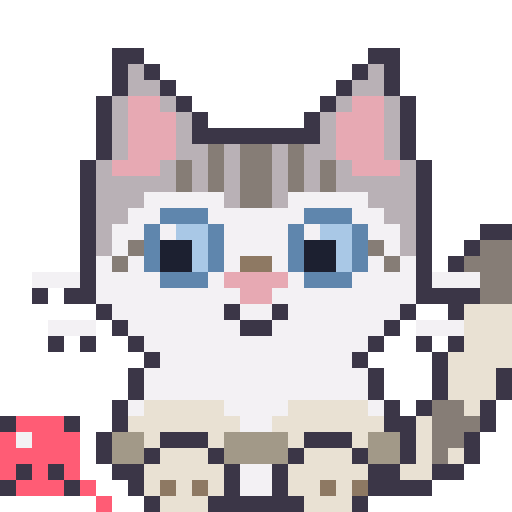 | **Jugar con un ovillo** | Un trabajo largo en cola: Koda se entretiene mientras espera. | [gif](gif/35-ovillo.gif) · [webp](webp/35-ovillo.webp) · [raw](https://raw.githubusercontent.com/Alvarogds04/koda/main/assets/koda/gif/35-ovillo.gif) |
| 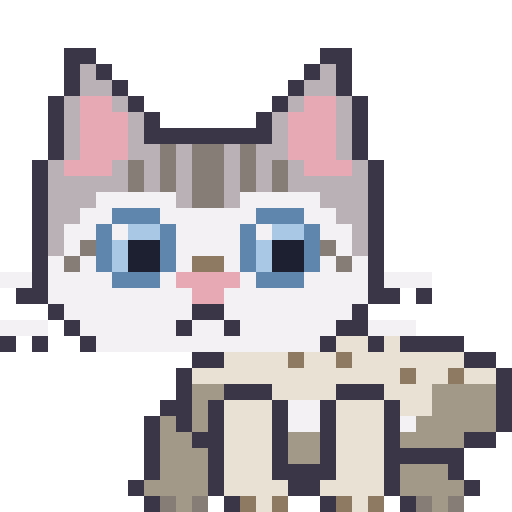 | **Perseguirse la cola** | Rato libre sin tareas: Koda se divierte solo. | [gif](gif/36-perseguir-cola.gif) · [webp](webp/36-perseguir-cola.webp) · [raw](https://raw.githubusercontent.com/Alvarogds04/koda/main/assets/koda/gif/36-perseguir-cola.gif) |
| 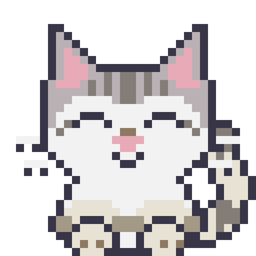 | **Saludar con la pata** | Al abrir Koda y al volver el usuario tras un rato. | [gif](gif/37-saludar.gif) · [webp](webp/37-saludar.webp) · [raw](https://raw.githubusercontent.com/Alvarogds04/koda/main/assets/koda/gif/37-saludar.gif) |
| 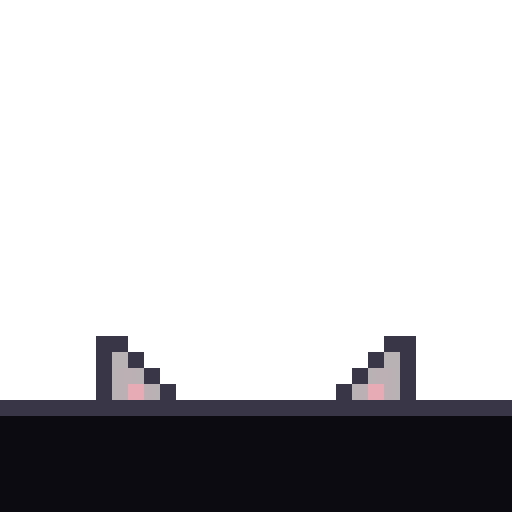 | **Asomarse por el borde** | Koda se asoma desde el borde de la isla al llegar un aviso: «hay algo». | [gif](gif/38-asomarse.gif) · [webp](webp/38-asomarse.webp) · [raw](https://raw.githubusercontent.com/Alvarogds04/koda/main/assets/koda/gif/38-asomarse.gif) |
| 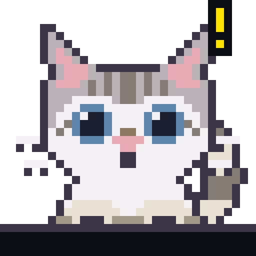 | **Esconderse** | Un error grave o un aviso inesperado: Koda se oculta tras el borde hasta que pase. | [gif](gif/39-esconderse.gif) · [webp](webp/39-esconderse.webp) · [raw](https://raw.githubusercontent.com/Alvarogds04/koda/main/assets/koda/gif/39-esconderse.gif) |
| 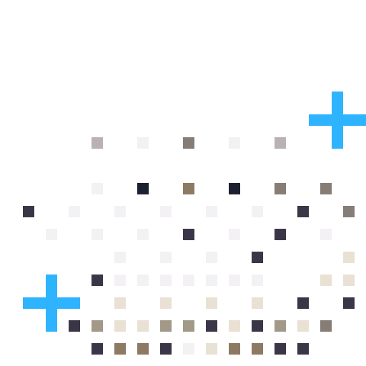 | **Aparecer** | Koda entra a la isla al abrir Koda o al llegar un nuevo trabajo. | [gif](gif/40-aparecer.gif) · [webp](webp/40-aparecer.webp) · [raw](https://raw.githubusercontent.com/Alvarogds04/koda/main/assets/koda/gif/40-aparecer.gif) |
|  | **Desaparecer** | Koda se va al cerrar Koda o al pausar el asistente. | [gif](gif/41-desaparecer.gif) · [webp](webp/41-desaparecer.webp) · [raw](https://raw.githubusercontent.com/Alvarogds04/koda/main/assets/koda/gif/41-desaparecer.gif) |
